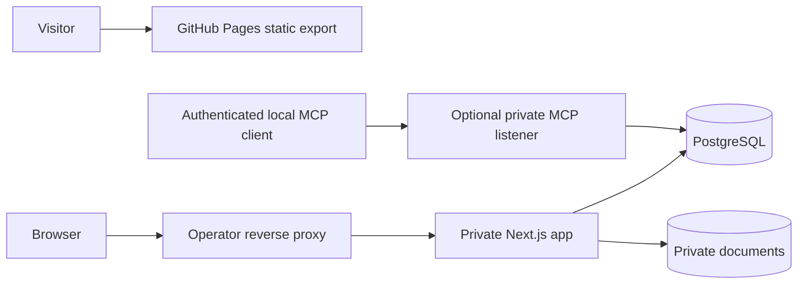

# Application architecture

## Boundaries

The public Next.js marketing app produces static HTML, assets and route payloads. GitHub Pages receives only that export. Marketing has its own public content and fictional previews and consumes no private app services or project plans.

The private Next.js app owns browser sessions, forms and APIs. Keep React views and route handlers thin. Use server-only services for authorization, use cases, transaction orchestration and audit recording, shared domain modules for invariant checks, and repositories for PostgreSQL access. A later private MCP process calls a narrow shared proposal interface, with its own authentication and database grants. Never route browser or MCP writes around the service invariants. Persist documents in a private volume with metadata in PostgreSQL.

The starter includes the first two Next.js applications and dev PostgreSQL. The running shell has no database driver or migrations. Add those with Application Foundation. Keep generated assets and secrets outside version control. The MCP listener and private documents service boundary are planned.

## Logical data model

| Records | Relationships and constraints |
| --- | --- |
| Household, user, session | One configured household. Accounts are distinct from patient profiles. Sessions have hashed identifiers, expiry and revocation. |
| Family member, provider, visit | Visit belongs to a member and references a provider. Household-scoped keys and immutable IDs. |
| Bill, bill adjustment | Bill may link to a visit and references the member and billing provider. Adjustments capture the signed effect, category, effective date and reason. |
| Payment, payment allocation | Positive cash event with one or more allocations to bills. Allocate at most the event total and keep any unapplied amount explicit. |
| Refund, refund allocation | Link to original payment allocations and cap cumulative refunds at their remaining paid amounts. |
| Plan, plan bill, installment, installment match | Plan scope and schedule version. Matching uses the existing payment allocation and cannot exceed the applicable schedule or payment. |
| Eligibility decision | Per payment allocation, with eligible amount, reason, decision state, evidence and effective date. |
| Claim, claim line, receipt, receipt allocation | Claim lines reserve eligible amounts by payment allocation. Receipts record cash and map to claim lines or directly to eligible allocations for externally initiated claims. Keep transitions and reversals. |
| Document, attachment, proposal | Opaque document ID, server-generated storage key, checksum, MIME, size and state. Use typed relationship tables or enforce foreign keys across any link design. Proposals bind evidence and target versions. |
| Audit event, idempotency record | Actor, scope, request identity, timestamp, entity and action. Store stable result references and payload fingerprints for mutation replay. |

Use migrations reviewed against both fresh and prior schema versions. Use explicit foreign keys, checks and uniqueness constraints for row-local invariants. Enforce cross-row aggregate limits under transaction locks or serializable retries. Post writes and audit in the same transaction. Serialize money as decimal strings for cents at external interfaces and validate strictly on ingest. Use date-only service and due dates and UTC timestamps for events. Store indexes for household, member, due date and linked financial records. Dates and money are normalized in the service boundary.

Use stable error codes for invalid input, forbidden access, stale versions and conflicts. Use cursor pagination and consistent sorting on large lists. Validate every record identifier and actor scope server-side. Include a source and license notice in the private UI and a source link on the marketing site.
